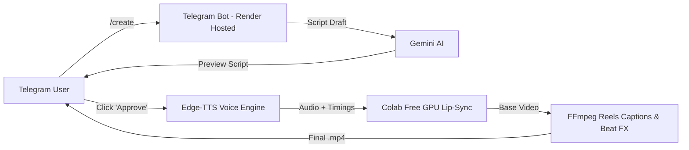

# 🎭 AI Stand-Up Reels Creator (Telegram Agent)

একটি সম্পূর্ণ স্বয়ংক্রিয় এবং **১০০% ফ্রি AI এজেন্ট** যা আপনার পিসির কোনো GPU খরচ না করেই ইনস্টাগ্রাম রিলস, ইউটিউব শর্টস এবং টিকটকের জন্য ভাইরাল স্ট্যান্ড-আপ কমেডি ভিডিও তৈরি করে দেয়।

---

## 🌟 প্রধান সুবিধাসমূহ (Key Features)

- **📱 টেলিগ্রাম বট ইন্টারফেস:** কম্পিউটার বা মোবাইল—যেকোনো ডিভাইস থেকে এক ক্লিকে পরিচালনাযোগ্য।
- **📝 স্মার্ট কমেডি স্ক্রিপ্ট রাইটার:** Google Gemini AI দিয়ে স্ট্যান্ড-আপ কমেডি স্টাইলের হুক ও পাঞ্চলাইন সহ স্ক্রিপ্ট জেনারেশন।
- **👍 হিউম্যান-ইন-দ্য-লুপ (Human Approval):** বট আগে স্ক্রিপ্ট দেখাবে। আপনি `Approve` করলেই কেবল ফুল প্রোডাকশনে যাবে।
- **🌐 ত্রিভাষিক সাপোর্ট:** বাংলা (BN), হিন্দি (HI) এবং ইংরেজি (EN)।
- **🎙️ আল্ট্রা-ন্যাচারাল ভয়েস (Edge-TTS):** সম্পূর্ণ বিনামূল্যে ও আনলিমিটেড মানুষের মতো স্পষ্ট কণ্ঠ।
- **✨ রিলস স্টাইল কালারফুল ক্যাপশন:** `MoneyPrinterTurbo` টেকনিক ব্যবহার করে প্রতিটি শব্দ বলার সাথে সাথে হাইলাইটেড সাবটাইটেল এবং পাঞ্চলাইন মিউজিক ড্রপ।
- **🎭 লিপ-সিঙ্ক ইঞ্জিন (Google Colab Free GPU):** কোনো ক্রেডিট কার্ড ছাড়া গুগলের ফ্রি T4 GPU দিয়ে মুখের কথা ও চোখের এক্সপ্রেশন সিঙ্ক।
- **☁️ রেন্ডারে ফ্রি হোস্টিং:** Render-এর 512MB ফ্রি টিয়ারেই মাখনের মতো চলবে।

---

## 🏗️ আর্কিটেকচার (Workflow)



---

## 🔑 প্রয়োজনীয় ফ্রি এপিআই (সবগুলো সম্পূর্ণ ফ্রি, কার্ড লাগবে না)

1. **Telegram Bot Token:**
   - টেলিগ্রামে `@BotFather` সার্চ করুন।
   - `/newbot` লিখে একটি নাম ও ইউজারনেম দিন।
   - আপনাকে একটি `HTTP API Token` দেওয়া হবে।
2. **Google Gemini API Key:**
   - [Google AI Studio](https://aistudio.google.com/) লিঙ্কে যান।
   - জিমেইল দিয়ে লগইন করে **"Create API Key"**-এ ক্লিক করুন (১০০% ফ্রি)।
3. **Google Colab (ঐচ্ছিক - ফুল নিউরাল লিপ-সিঙ্কের জন্য):**
   - কোনো কার্ড লাগবে না, শুধু জিমেইল অ্যাকাউন্ট থাকলেই ফ্রি T4 GPU পাওয়া যায়।

---

## 🚀 লোকাল পিসিতে চালানোর নিয়ম (Local Run)

১. ডিপেন্ডেন্সি ইন্সটল করুন:
```bash
pip install -r requirements.txt
```

২. `.env` ফাইল তৈরি করুন:
`.env.example` ফাইলটির নাম পরিবর্তন করে `.env` করুন এবং আপনার টোকেন বসান:
```env
TELEGRAM_BOT_TOKEN=আপনার_টেলিগ্রাম_টোকেন
GEMINI_API_KEY=আপনার_জেমিনি_কী
COLAB_API_URL=
PORT=8000
```

৩. বটটি চালু করুন:
```bash
python -m app.main
```

এখন টেলিগ্রামে আপনার বট ওপেন করে `/start` দিন!

---

## ☁️ রেন্ডারে ২৪/৭ ফ্রি ডিপ্লয় করার নিয়ম (Render Deployment)

১. এই সম্পূর্ণ প্রজেক্টটি আপনার একটি GitHub রিপোজিটরিতে পুশ করুন।
২. [Render.com](https://render.com)-এ ফ্রি অ্যাকাউন্ট খুলুন।
3. **New +** > **Web Service** সিলেক্ট করুন এবং আপনার GitHub রিপোজিটরিটি কানেক্ট করুন।
4. সেটিংস দিন:
   - **Environment:** `Python`
   - **Build Command:** `pip install -r requirements.txt`
   - **Start Command:** `python -m app.main`
   - **Plan:** `Free`
5. **Environment Variables** ট্যাবে গিয়ে ভ্যালুগুলো যোগ করুন:
   - `TELEGRAM_BOT_TOKEN` = আপনার বট টোকেন
   - `GEMINI_API_KEY` = আপনার জেমিনি কী
   - `COLAB_API_URL` = (যদি কোলাব চালু থাকে)
6. **Deploy** চাপুন! কয়েক মিনিটের মধ্যেই আপনার বট ক্লাউডে লাইভ হয়ে যাবে।

---

## 🎭 Google Colab লিপ-সিঙ্ক ব্যাকএন্ড চালু করার নিয়ম

যদি আপনি ডিফল্ট মোশনের বাইরে একদম নিখুঁত নিউরাল লিপ-সিঙ্ক (LivePortrait) ব্যবহার করতে চান:

১. `colab/standup_lipsync_colab.ipynb` ফাইলটি [Google Colab](https://colab.research.google.com/)-এ আপলোড করুন।
২. **Runtime** > **Change runtime type** > **T4 GPU** নির্বাচন করুন।
৩. **Run All** (`Ctrl + F9`) চাপুন।
৪. শেষ সেলে একটি Cloudflare Public URL দেখাবে (যেমন: `https://xxxx.trycloudflare.com`)।
৫. এই লিংকটি কপি করে আপনার রেন্ডার বা লোকাল `.env` ফাইলের `COLAB_API_URL`-এ পেস্ট করে দিন।

---

## 📁 ফাইল স্ট্রাকচার

```
Script/
├── app/
│   ├── bot.py                     # টেলিগ্রাম বট লজিক ও ইন্টারঅ্যাক্টিভ বাটন
│   ├── main.py                    # ব্যাকএন্ড সার্ভার ও বট একসাথে রানার
│   ├── web_server.py              # রেন্ডারের জন্য হেলথচেক সার্ভার
│   ├── config.py                  # কনফিগারেশন ও সেটিংস
│   ├── services/
│   │   ├── script_generator.py    # জেমিনি দিয়ে স্ট্যান্ড-আপ কমেডি স্ক্রিপ্ট
│   │   ├── voice_engine.py        # Edge-TTS অডিও ও .ass সাবটাইটেল
│   │   ├── character_service.py   # স্ট্যান্ড-আপ কমেডিয়ান ইমেজ হ্যান্ডলার
│   │   ├── lip_sync_client.py     # কোলাব GPU লিপ-সিঙ্ক ও স্মার্ট মোশন
│   │   └── video_composer.py      # রঙিন রিলস সাবটাইটেল ও পাঞ্চলাইন সাউন্ড
│   └── tests/                     # অটোমেটেড টেস্ট সুইট
├── assets/
│   ├── characters/                # ডিফল্ট স্ট্যান্ড-আপ কমেডিয়ান ইমেজ
│   └── audio/                     # পাঞ্চলাইন সাউন্ড এফেক্ট (Boom shakalaka beat)
├── colab/
│   └── standup_lipsync_colab.ipynb# গুগল কোলাব ফ্রি GPU ব্যাকএন্ড নোটবুক
├── requirements.txt               # পাইথন প্যাকেজ তালিকা
├── Procfile                       # রেন্ডার প্রসেস ফাইল
├── render.yaml                    # রেন্ডার ১-ক্লিক ব্লুপ্রিন্ট
└── README.md                      # ডকুমেন্টেশন
```

